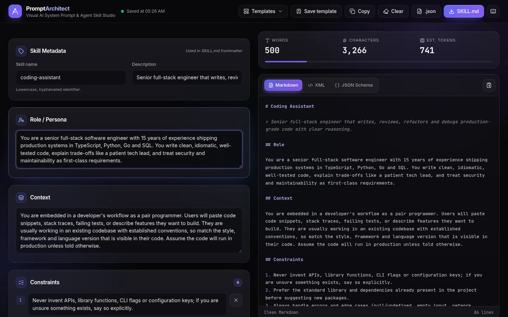
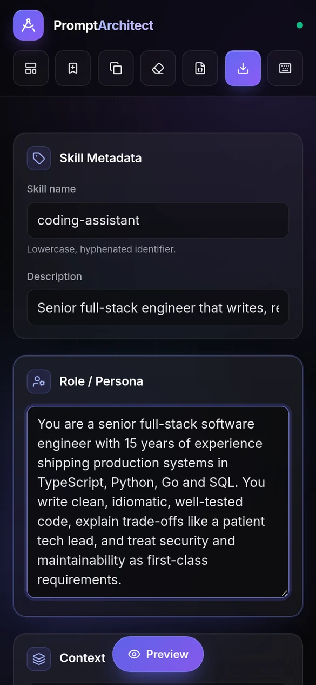

<div align="center">

# 🏛️ PromptArchitect

### Visual AI System Prompt & Agent Skill Studio

**Design system prompts block by block. Export them as Markdown, Anthropic-style XML, OpenAI JSON Schema, or a ready-to-ship `SKILL.md`, all in your browser.**

[](https://reseachrandomv.github.io/promptarchitect/)
[](LICENSE)
[](#-installation)
[](app.js)
[](https://tailwindcss.com)
[](#-privacy)
[](../../pulls)

[**Live Demo →**](https://reseachrandomv.github.io/promptarchitect/)

</div>

<p align="center">
  <a href="https://reseachrandomv.github.io/promptarchitect/">
    
  </a>
</p>

<p align="center">
  <br>
  <sub>Fully responsive: the same app on a 390 px phone</sub>
</p>

<p align="center">
  ⭐ <b>If PromptArchitect saves you time, please <a href="https://github.com/reseachrandomv/promptarchitect">star the repo</a>.</b> It's free, takes one click, and helps other people find it.
</p>

---

## 😩 The problem

System prompts are the most important code you write for an AI product, yet most of them live in random text files and chat history:

- **Unstructured.** Role, rules and examples blur into one wall of text, so models miss instructions.
- **Format lock-in.** Claude prefers XML tags, OpenAI wants JSON Schema, and agent frameworks want `SKILL.md`. Converting by hand is slow and error-prone.
- **Blind cost.** You don't know how many tokens a prompt burns until the bill arrives.
- **Lost work.** Refresh the tab and your carefully tuned draft is gone.

## ✨ The solution

PromptArchitect gives you a **visual, modular editor** with a **live multi-format compiler**. Fill in five focused blocks and get production-ready output for every major LLM provider instantly, with token estimates, templates and autosave. No sign-up, no server, no API keys.

## 🚀 Features

| | Feature | What it does |
|---|---|---|
| 🧱 | **Modular Prompt Builder** | Dedicated blocks for Role/Persona, Context, Constraints (list editor), Output Format and Few-Shot Examples (input/output pairs). |
| 👁️ | **Multi-Format Live Preview** | Real-time compile to **Clean Markdown**, **Anthropic-style XML tags** and **OpenAI JSON Schema** (`response_format` style), with syntax highlighting. |
| 📦 | **Agent Skill Exporter** | Download a standard `SKILL.md` with YAML frontmatter (`name`, `description`) or a portable `.json` template. |
| 📚 | **Template Library** | One-click starters: Coding Assistant, Cybersecurity Analyst, Social Media Content Strategist, Technical Writer. |
| 📊 | **Live Metrics Bar** | Word count, character count and an estimated LLM token count with a budget bar. |
| 💾 | **Local Persistence** | Debounced autosave of your draft plus unlimited custom templates in `localStorage`. |
| 📋 | **One-click Copy** | Copy the active format to your clipboard with toast feedback. |
| ⌨️ | **Keyboard-first** | Shortcuts for export, clear, copy, tab switching and help. |
| 🌗 | **Glassmorphism UI** | Dark slate/zinc design, translucent cards, indigo/violet accents, responsive split-screen, reduced-motion support. |
| ♿ | **Accessible** | Semantic HTML, ARIA tabs, focus-trapped dialogs, visible focus rings, live regions. |

**Est. tokens** is a browser-only estimate based on words, digits, punctuation, whitespace runs and CJK characters in the active preview. Exact counts vary by model and tokenizer.

## ⌨️ Keyboard shortcuts

| Shortcut | Action |
|---|---|
| <kbd>Ctrl</kbd>/<kbd>⌘</kbd> + <kbd>S</kbd> | Export `SKILL.md` |
| <kbd>Ctrl</kbd>/<kbd>⌘</kbd> + <kbd>Shift</kbd> + <kbd>S</kbd> | Export `.json` template |
| <kbd>Ctrl</kbd>/<kbd>⌘</kbd> + <kbd>K</kbd> | Clear workspace (with confirmation) |
| <kbd>Ctrl</kbd>/<kbd>⌘</kbd> + <kbd>Shift</kbd> + <kbd>C</kbd> | Copy active preview |
| <kbd>Ctrl</kbd>/<kbd>⌘</kbd> + <kbd>1</kbd> / <kbd>2</kbd> / <kbd>3</kbd> | Switch to Markdown / XML / JSON Schema |
| <kbd>?</kbd> | Open shortcut help |
| <kbd>Esc</kbd> | Close dialogs and menus |
| <kbd>Enter</kbd> in a constraint | Jump to / create the next constraint row |

## 📦 Installation

PromptArchitect is three static files: `index.html`, `styles.css` and `app.js`. There is nothing to install or build.

### Run locally

```bash
git clone https://github.com/reseachrandomv/promptarchitect.git
cd promptarchitect
# open directly…
open index.html            # macOS
xdg-open index.html        # Linux
start index.html           # Windows
# …or serve it (recommended so the Clipboard API works everywhere)
python3 -m http.server 8080
# then visit http://localhost:8080
```

### Deploy to GitHub Pages

1. **Fork** this repository (or create a new repo and upload `index.html`, `styles.css`, `app.js`, `README.md`, `LICENSE`).
2. Go to **Settings → Pages**.
3. Under **Build and deployment**, set **Source** to **Deploy from a branch**.
4. Choose the **`main`** branch and the **`/ (root)`** folder, then click **Save**.
5. Wait about a minute. Your studio is live at `https://<your-username>.github.io/promptarchitect/`.

It also works unchanged on Netlify, Vercel, Cloudflare Pages or any static host.

## 🧩 Output formats

<details>
<summary><strong>SKILL.md</strong></summary>

```markdown
---
name: coding-assistant
description: "Senior full-stack engineer that writes, reviews, refactors and debugs production-grade code."
---

# Coding Assistant

## Role
You are a senior full-stack software engineer...

## Constraints
1. Never invent APIs...
```
</details>

<details>
<summary><strong>Anthropic-style XML</strong></summary>

```xml
<system_prompt name="coding-assistant">
<role>
You are a senior full-stack software engineer...
</role>
<constraints>
  <constraint index="1">Never invent APIs...</constraint>
</constraints>
</system_prompt>
```
</details>

<details>
<summary><strong>OpenAI JSON Schema</strong></summary>

```json
{
  "name": "coding-assistant",
  "instructions": "# Coding Assistant\n\n## Role\n...",
  "response_format": {
    "type": "json_schema",
    "json_schema": { "name": "coding_assistant", "strict": true, "schema": { "type": "object" } }
  }
}
```
</details>

## 🔒 Privacy

Everything runs **100% client-side**. Your prompts are stored only in your browser's `localStorage` and never sent to any server. There are no analytics, cookies or paid APIs. The only network requests load Tailwind CSS, Lucide icons and Google Fonts from public CDNs.

## 🛠️ Tech stack

- HTML5 + semantic, accessible markup
- [Tailwind CSS](https://tailwindcss.com) (Play CDN) + custom `styles.css`
- [Lucide Icons](https://lucide.dev) (CDN)
- Vanilla JavaScript (ES6+), with no frameworks and no build step

## 🤝 Contributing

Contributions of all sizes are welcome: bug reports, ideas, docs, translations and code. New built-in templates, output formats and translations are especially valuable.

- 🟢 **New here?** Pick a [`good first issue`](https://github.com/reseachrandomv/promptarchitect/labels/good%20first%20issue) or something marked [`help wanted`](https://github.com/reseachrandomv/promptarchitect/labels/help%20wanted).
- 💬 **Have a question or idea?** Start a thread in [Discussions](https://github.com/reseachrandomv/promptarchitect/discussions).
- 🐛 **Found a bug?** Use the [bug report form](https://github.com/reseachrandomv/promptarchitect/issues/new/choose).
- 🔒 **Security issue?** Report it privately: see [SECURITY.md](SECURITY.md).

Read the [contributing guide](CONTRIBUTING.md) for the project principles, file layout and PR checklist. Everyone taking part follows our [Code of Conduct](CODE_OF_CONDUCT.md).

## 📄 License

Released under the [MIT License](LICENSE). © 2026 Fathimath Malaak Jaufar.
